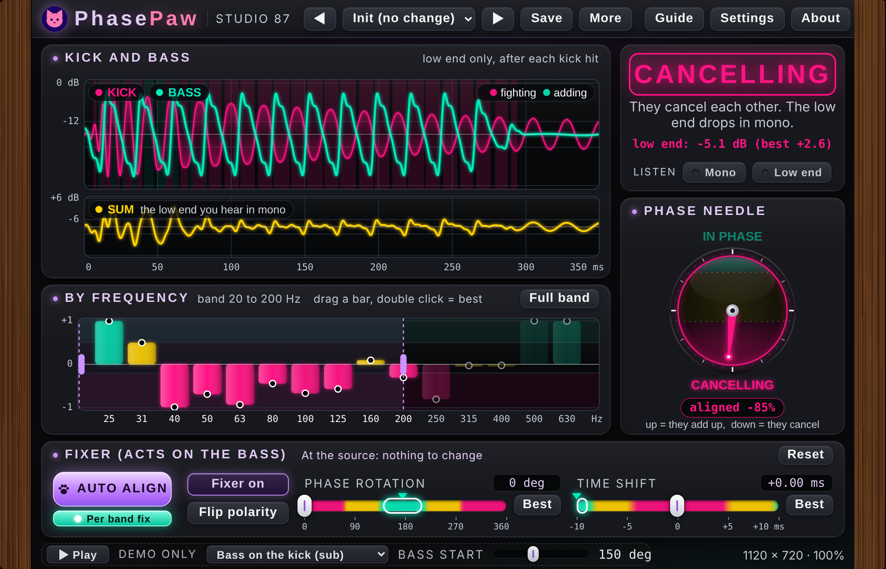

# PhasePaw

See whether your kick and bass work together or fight each other, and fix it.

*The picture shows the design mockup, not a compiled plugin window.*

## Status

Design stage. There is no plugin build to download yet. The interactive mockup is in `docs/mockups/` (open the HTML file in a browser). The plugin will be built to look and behave like that mockup.

## What it will do

- Sits on the bass track; the kick comes in through the sidechain input.
- Shows kick and bass on top of each other, plus their sum (what the low end sounds like in mono).
- One verdict: in phase, careful, or cancelling, shown against the best this kick and bass can reach, with the level change of the low end in dB.
- A phase needle: up means kick and bass add up, down means they cancel.
- A view by frequency (third-octave bars); drag a bar to turn the phase of that band only.
- Fixer for the bass: polarity flip, phase rotation (0 to 360 degrees), time shift (-10 to +10 ms), and Auto Align, which sets all three in one click and also turns each band to its own best phase (can be switched off).
- The fixer only works inside the chosen band (default 20 to 200 Hz), so the rest of the bass stays untouched.
- A "fix at the source" hint: the same correction as a synth start phase or a clip nudge in ms, so the fixer can stay off.
- A warning when the bass phase jumps from hit to hit (free-running oscillators), with the advice to turn on retrigger.
- Listen buttons: Mono (kick and bass folded to mono) and Low end (only the chosen band).
- A sweet spot outline on both sliders: anywhere inside it the result stays in phase, so you can choose by ear.

## Planned

- VST3 for Linux first, then Windows and macOS.
- Offline installers with a manual and an uninstaller.
- No telemetry, no network access.

See [ROADMAP.md](ROADMAP.md).

## Licence

AGPL-3.0-or-later. See [LICENSE](LICENSE).

## Support

PhasePaw is free and open source, part of the Studio 87 plugin suite. If you like it: https://ko-fi.com/studio87
